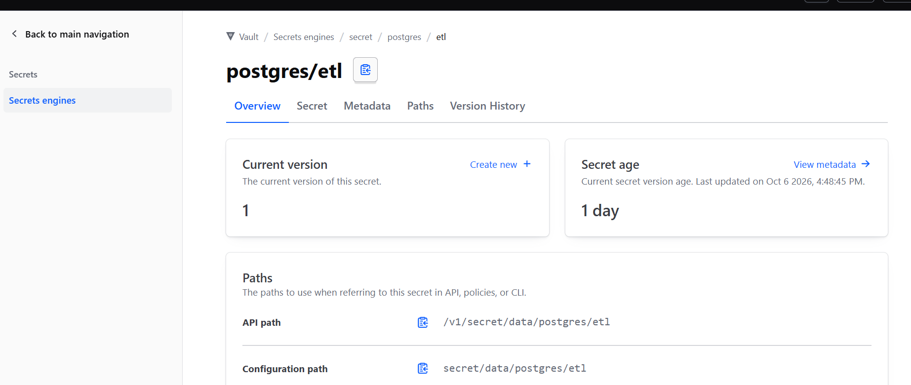

### Step 1 : importing hvac

- Importing hvac
```python
import hvac
```

- hvac is the official python library used to communicate with hashicorp vault.

### Step 2 : creating your logger object

```python
logger = logging.getLogger(__name__)
```

- Why? Instead of calling logging.info(), we will use logger.info() so our messages carry the name of this script.

### Step 3 : Define where the vault lives and your secret token


```python
hvac_url = "http://127.0.0.1:8200"
hvac_token = "YOUR_VAULT_TOKEN"
```

- hvac_url : The address where local vault server is running
- hvac token : The access key generated when you start vault.

### Initialize the Vault Client

```python
client = hvac.Client(url = hvac_url, token = hvac_token)
```

- hvac.Client(...) sets up the connection object.


### Check if the connection is acutally working or not

- if is_authenticated is true then the connection successful otherwise not.

```python
if client.is_authenticated():
    print("Connection Successful")
else:
    print("Connection Not succesful")
```

### Step 6 : Know your secrets path & Mount Point

- Mount Point : The engine name (by default in dev mode, this is "secret".)

- Path : The name/folder of your secret (for)

- if the path is Vault/SecretsEngine/secret/postgres/etl
- **Mount Point** : "secret" (the keyword after secretsengine)
- **path** : postgres/etl "The keyword after Mount Point"

### Step 7 : Connect to the vault and fetch the secrets

```python
response = client.secrets.kv.v2.read_secret_version(mount_point="secret", path="postgres/etl")
```

- The Above line refers to
- client : Hey Vault client(which we already used to connect the variable)
- secrets : go to the secrets department  which is under back to main navigation.
- kv : There are so many engines currently we are using kv(key value engine),
- v2 : There are two vesions (currently we are using v2)
    - v1 - dont store the previous version
    - v2 - stores both the versions of the password
- read_secret_version : This is the function to read the passwords.


- The response sends a request to vault to retrive the latest version of the secret stored at that path.
- unpacking the secrets dictionary :
- Why are we using secrets = respose['data']['data']
```python
{
    "request_id": "1a2b3c4d-...",
    "lease_id": "",
    "renewable": False,
    "data": {                                  # ⬅️ First ["data"]
        "metadata": {                          # Info ABOUT the secret
            "created_time": "2026-10-06T...",
            "version": 1,
            "destroyed": False
        },
        "data": {                              # ⬅️ Second ["data"] (YOUR REAL SECRETS)
            "username": "etl_user",
            "password": "my_secret_password",
            "host": "localhost",
            "port": 5432,
            "database": "postgres"
        }
    }
}
```

```python
response['data']['data'] reveals :
{
    "username": "etl_user",
    "password": "my_secret_password",
    "host": "localhost",
    "port": 5432,
    "database": "postgres"
}
```

- Vault wraps secrets inside an envelope. The first ["data"] contains metadata (version, timestamp), and the second ["data"] contains your actual credentials dictionary.
